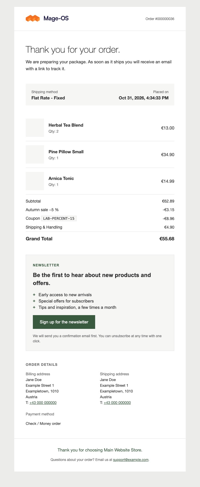
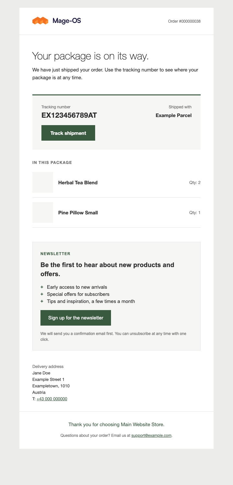
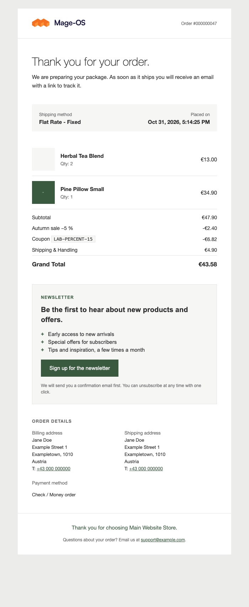
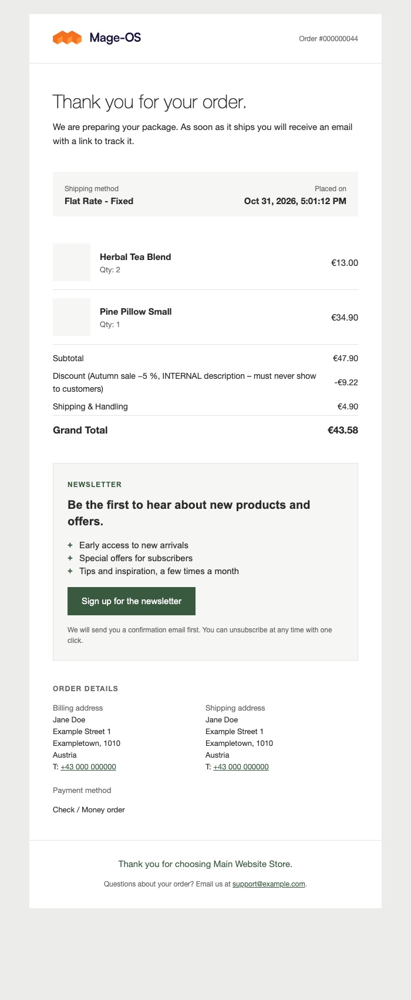
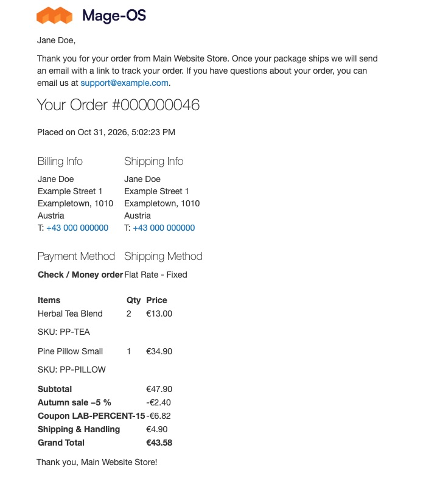

# Sales Email for Magento 2

Modern, email-client safe transactional emails for Magento 2: a short friendly summary, compact items, totals, a
configurable invitation block (for example a newsletter invitation) and the address and payment details at the bottom.
Table-based markup, English and German copy.

| Order confirmation | Shipment |
|---|---|
|  |  |

## What it does

- **Order confirmation** (customer and guest): header with logo and order number, headline and intro, info strip
  (shipping method, order date), compact items with image, name, quantity and price, totals, invitation block,
  billing and shipping address, payment method, store contact footer.
- **Shipment** (customer and guest): tracking strip with number, carrier and a "Track shipment" button, the items in
  the package with the shipped quantity, invitation block, delivery address.
- Bundle, downloadable and gift message items are rendered; products without an image get a neutral placeholder cell.
- Invoice and credit memo emails are planned, not part of v1.

## Requirements

- PHP 8.3 with `ext-intl`
- Magento 2.4.x or Mage-OS (see `composer.json` for the exact Magento module constraints)
- Optional: [`pixelperfectat/magento2-module-discount-lines`](https://github.com/pixelperfectat/magento2-module-discount-lines)

## Installation

```
composer require pixelperfectat/magento2-module-sales-email
bin/magento setup:upgrade
bin/magento cache:flush
```

The setup creates the default invitation CMS block `pp_sales_email_invitation` (an existing block with that
identifier is left untouched).

## Configuration

Stores > Configuration > Sales > Modern Sales Emails. All settings exist at default, website and store view scope.

| Path | Default | Meaning |
|---|---|---|
| `pp_sales_email/general/enabled` | `1` | Use the modern templates. `0` = this store view keeps using the core templates. |
| `pp_sales_email/invitation/cms_block` | empty | Identifier of the CMS block shown as invitation. Empty = no invitation. |
| `pp_sales_email/invitation/enabled_for` | `order,shipment` | Emails that include the invitation block. |

The module registers its templates as the default for `sales_email/order/{template,guest_template}` and
`sales_email/shipment/{template,guest_template}`. With `enabled = 0` for a store view, that store view gets the core
templates again; other store views are not affected.

### Enable per store view, and the rollout note

Set `pp_sales_email/general/enabled` at the store view scope to switch one store on or off.

**Stores that explicitly saved the core template id keep the core template.** If a store view has its own value for
"New Order Confirmation Template" or "Shipment Template" saved in Stores > Configuration > Sales > Sales Emails (the
core id, not "(Default)"), the module does not override it. Clear that override ("Use Default Value") or pick the
modern template in the dropdown to switch the store to the new layout.

### Show the invitation

Pick the CMS block in "Invitation Block > CMS Block" (the default block is installed but not selected) and choose
the emails in "Show In". The invitation appears below the totals (order) or below the items (shipment).

## Overriding templates

Copy a template into your theme and change it:

```
<theme>/PixelPerfect_SalesEmail/email/order_new.html
<theme>/PixelPerfect_SalesEmail/email/order_new_guest.html
<theme>/PixelPerfect_SalesEmail/email/shipment_new.html
<theme>/PixelPerfect_SalesEmail/email/shipment_new_guest.html
```

Alternatively use Marketing > Communications > Email Templates > Add New Template > "Load template" and select one of
the module's templates, then select your copy in the Sales Emails configuration.

## Overriding the palette

All colours live in one stylesheet that is inlined into the emails: `PixelPerfect_SalesEmail::css/pp-sales-email.css`.
Defaults: ink `#2b2b2b`, muted `#6b6b6b`, line `#e3e3e3`, tint `#f6f6f4`, accent `#3a5a40`. Ship the same file in your
theme (`<theme>/PixelPerfect_SalesEmail/web/css/pp-sales-email.css`) or in a small shop module to change them. The
templates repeat a few colours as `bgcolor` attributes (button cell, tracking box, item placeholder, page background
`#ececea`) for clients that ignore CSS; override those in your template copies. The default invitation block carries
its own inline colours and a `bgcolor` button cell; edit the CMS block to match.

## Invitation block

The block is a normal CMS block, so editors change its text and button in the admin. It is sanitised for email
before it is rendered.

- **Allowed tags:** `table tbody thead tr td th p a strong b em i br span div h1 h2 h3 ul ol li img hr`. Unknown tags
  are unwrapped (their children stay).
- **Removed together with their content:** `script style link svg form input button iframe object embed meta base
  textarea select noscript template math`.
- **Allowed attributes:** `href src alt width height style align valign border cellpadding cellspacing role title bgcolor`.
  Every other attribute (for example `onclick`, `class`, `id`) is dropped.
- **URL schemes** in `href` and `src`: `http`, `https`, `mailto`, `tel`, and relative URLs. Others such as
  `javascript:` or `data:` are dropped.
- **Style rules:** inline `style` only; a value is dropped when it contains backslash escapes, comments,
  `expression`, `behavior`, `javascript`, `vbscript`, `-moz-binding`, `@import` or a `url()` with a non-http(s) scheme.
- Keep to email-safe markup: no flex or grid, no web fonts, no SVG, PNG images with absolute URLs.

The warning when saving the CMS block (Content > Blocks) checks the **raw content** only. CMS directives
(`{{widget}}`, `{{block}}`, `{{store url=''}}`) are expanded at render time and their output is sanitised then, so
unsafe markup produced by a directive is removed silently.

The default button links to the store home with a `#newsletter` anchor (`{{store url=''}}#newsletter`) because core
Magento has no newsletter sign-up page. Point the link at your sign-up page, or make sure your theme has an element
with that anchor.

## Discount lines

If `pixelperfectat/magento2-module-discount-lines` is installed, the totals render one row per discount rule: the
module detects rows that carry the `discount_line` data key (coupon code in a monospace chip, "Gift" or "Free" in the
amount cell for zero-amount gift and free shipping lines). Contract:
[Contract with the sales-email module](https://github.com/pixelperfectat/magento2-module-discount-lines#contract-with-the-sales-email-module).
Without it, or with its switch off, the core `discount` row is rendered. Neither package requires the other.
The small icons next to discount lines follow `pp_discount_lines/documents/email_icon` (default off); the icons are
shipped by this module.

| Both enabled | Sales email only | Discount lines only |
|---|---|---|
|  |  |  |

"Sales email only" shows Magento's own discount row, unchanged. Core Magento appends the sales rule's
description to that label, so an internal note in the rule description reaches the customer. The
[Discount Lines](https://github.com/pixelperfectat/magento2-module-discount-lines) module replaces that row
with one line per rule and never shows the description.

## Translations

The module ships `en_US` and `de_DE` (formal "Sie") for its own strings only. Strings that Magento core already
owns (Subtotal, Grand Total, Shipping & Handling, Coupon, the order subject and so on) are not duplicated; they come
from the language pack installed for the store. The "Gift" label in the amount cell comes from the discount-lines
module.

## Known limits

- Bundle, downloadable and gift-card items are styled at a basic level; unusual item renderers from other modules
  fall back to the default row.
- The invitation text is not translated per locale unless the CMS block is assigned per store view.
- The `@media` block for narrow screens depends on the email inliner keeping the `<style>` element; clients that
  strip it show the desktop layout.
- Real product images have not been tested in the lab (placeholder cells only); image URLs are resolved through the
  store emulation of the order's store.
- Without discount lines, the core discount row shows the discount label core builds (the rule label or the coupon code).
- Blocks saved by an import or a direct resource-model save skip the admin warning; their content is still sanitised
  at render.
- Tracking links point to the core tracking popup, not to the carrier's own page.

## Screenshots

Placeholder data only, in `docs/screenshots/`: order confirmation, shipment, German variants, bundle, gift,
discount icons, core discount row.

## Development

```
composer install
composer check
```

`composer check` runs composer validate, PHP lint, PHP_CodeSniffer, PHPStan, PHPUnit and Infection mutation testing
(fails below MSI 85 or covered-code MSI 90). Infection needs a coverage driver: enable pcov, or Xdebug with
`XDEBUG_MODE=coverage`. `composer infection` runs the mutation tests on their own.

## License

MIT, see `LICENSE`.
